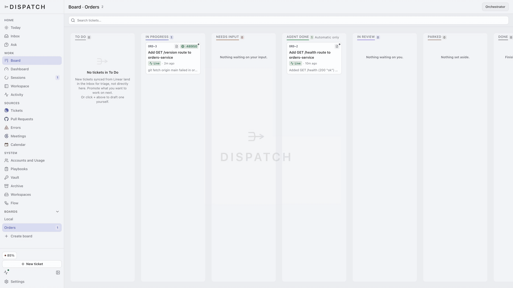

# Dispatch

[](https://github.com/theyashgupta/dispatch/actions/workflows/ci.yml)
[](LICENSE)
[](https://nodejs.org)

Dispatch is a local kanban board for Claude Code. Each ticket gets its own git worktree and its own Claude session in tmux. The browser shows the real terminal of each session. An orchestrator session reads your directions, writes tickets, starts loops and ships the branches. Tickets come from Linear, GitHub, Slack, meetings and your calendar, or you write them yourself. Everything runs on your computer.



[Watch the demo as an MP4 video](docs/media/dispatch-demo.mp4).

<a id="getting-started"></a>

## Install and first run

You need macOS or Linux with these tools:

- Node.js 22.22 or later.
- `tmux` and `ttyd`. On macOS, run `brew install tmux ttyd`.
- `git`.
- The [Claude Code](https://docs.anthropic.com/en/docs/claude-code) CLI (`claude`), logged in to your account.

Start Dispatch with one command:

```bash
npx @theyashgupta/dispatch
```

Or install it globally, then start it:

```bash
npm install -g @theyashgupta/dispatch
dispatch
```

Dispatch checks the required tools at startup and names each missing tool. It listens on port 4700, or on a free port when 4700 is in use. It prints the URL and opens your browser.

The first run opens a setup guide with five steps. Connect a source in the guide, or choose **Skip for now** and connect it later in **Settings**. No source is necessary to use the board.

These commands are also available:

- `dispatch doctor` checks the required tools, then stops.
- `dispatch service install` runs Dispatch as a background launchd service on macOS.
- `dispatch service status` shows the state of the service. `restart` and `uninstall` are also valid.
- `dispatch update` checks for a new version and shows the update steps.
- `dispatch uninstall` removes the hooks and the launchd file. Your data and worktrees stay.
- `dispatch -h` shows all commands and options, for example the port option.

Dispatch keeps its data in `~/.dispatch`. Set `DISPATCH_DIR` to use a different folder.

## Boards and the orchestrator

### Boards

A board holds the tickets, the repositories and the policy of one project. The board has these columns: **To Do**, **In Progress**, **Needs Input**, **Agent Done**, **In Review**, **Parked** and **Done**.

- The **Boards** section of the sidebar lists each board. Select a board to open it. Press `B` to switch boards from the keyboard.
- The **Dashboards** section of the sidebar lists each board that has an orchestrator. Select a board to open its dashboard.
- **Manage boards** in the command palette (`Cmd+K` or `Ctrl+K`) opens the boards page. There you create, edit, archive and restore boards. Each board also has a settings page.
- On a screen 1024 px wide or wider, choose **Split** to show two boards side by side or stacked.

To start a ticket by hand, drag its card to **In Progress**. The start dialog opens. Select the repositories, a playbook and an optional direction. Dispatch makes a worktree for each repository on a branch named after the ticket. Then it starts `claude` in tmux and sends the ticket as the first prompt.

Select a card to open the card detail panel. The panel shows the live terminal, the ticket text, the timeline, the comments and the pull requests of the card. A session reports its state with a status line. When the session asks a question, the card moves to **Needs Input** and shows the question. When the session finishes, the card moves to **Agent Done**. When you move a card to **Done**, Dispatch stops the session and removes the worktrees. Dispatch keeps the branches.

When a session stops, for example after a restart, the card shows **Resume**. Resume starts Claude again in the same worktree and opens the same conversation.

### The orchestrator terminal

The orchestrator is a Claude session that coordinates the work of one board. It uses the Dispatch tools. It cannot edit code and it cannot change the board policy.

1. Open a board. Choose **Add orchestrator** in the page header. The command centre opens.
2. Choose **Settings** to open the policy. Make sure that the supervisor is **On**.
3. Choose **Start**.

The command centre shows the orchestrator, one tile for each ticket and group that it runs, and its terminal. The terminal is the only way to talk to the orchestrator. It is the real Claude terminal, not a chat view.

### How a direction becomes tickets

Type a direction in the orchestrator terminal, for example "Add a health check endpoint to the orders service". Then:

1. The orchestrator reads the board and the rule book.
2. It writes one ticket, or several related tickets, on the board.
3. It selects a playbook for each ticket. Two or more related tickets become a group that one session runs.
4. It writes one plan as a decision item.
5. You approve the plan in the dashboard. A board policy can also approve plans without you.
6. The orchestrator starts each ticket or group inside the limit **Loops at once**.

### How a loop ships

A loop is a session that works through a plan phase by phase. The supervisor is the part of the Dispatch server that watches each loop.

- The supervisor sends a continue prompt, a handoff request or a resume when a loop needs one.
- When the context of a loop fills, the supervisor starts a fresh conversation at the same place in the plan.
- When the account reaches a usage limit, the supervisor waits for the reset or stops, as the policy tells it.
- Dispatch refuses a new loop when the free memory of the Mac is below the floor in the policy.

The dashboard shows the progress of each loop, the items that need you, and the cost against the budget. When a loop reaches **Agent Done**, the orchestrator starts the ship flow. The flow checks each branch, pushes it, opens its pull request and merges it in order. The policy **Ship rights** sets how far the flow goes:

- **None, I ship**: you ship the branches.
- **Open PRs**: the flow opens the pull requests and you merge them.
- **Open and merge PRs**: the flow also merges the pull requests.

The [user guide](docs/user-guide.md) gives the full details of boards, the policy, the dashboard and the ship flow.

## Playbooks

A playbook is a markdown file that tells a session how to work. Dispatch adds the playbook to the first prompt of the session. Open **Playbooks** in the sidebar to edit, copy or delete a playbook, or to add your own.

Dispatch seeds these playbooks:

- **Write code directly**: a small ticket that needs no process.
- **PRD + Ralph Loop**: one ticket that needs a phased plan, QA and a gap analysis.
- **Roadmap Loop**: two or more related tickets that one group session runs unit by unit.
- **Superpowers**: a ticket that needs an approved design before code.
- **GSD**: a repository that uses the GSD workflow.
- **Review a pull request**: one pull request to review. The **Review** button selects it.
- **Board Orchestrator**: the orchestrator session. Dispatch selects it.
- **Release**: a release card. The orchestrator starts it.

Dispatch updates a seeded playbook at startup only when you did not edit it.

## Accounts and usage

Dispatch can use more than one Claude account. Each account keeps its own Claude configuration folder. Dispatch never copies or changes a credential.

- The usage counter at the bottom of the sidebar shows the highest usage percent. Select it to open the usage popover.
- The popover shows the session window and the weekly window of the account. Use **Switch account** in the popover to start new sessions on a different account.
- The **Accounts and Usage** page lists each account and its state. Choose **Add account** to log in to one more Claude account.
- On the same page, the **Account chain** can move sessions to an account with headroom at a usage limit. **Automatic moves** is off by default.

## Sources

Connect each source in **Settings**, **Connections**. Each source is optional.

- **Linear.** Add a personal API key. Filters select the tickets to sync. The tickets show on **Tickets**, in the **Inbox** and on the boards.
- **GitHub.** Add a personal access token to the vault, or use your `gh` login. The pull requests show on **Pull Requests**.
- **Slack.** Add a Slack user token to the vault, or use the Claude Slack connector. The messages show on **Slack** and in the **Inbox**.
- **Meetings.** Dispatch uses the Granola connector of your Claude login. Each hour it reads the action items of recent meetings. They show on **Meetings** and **Today**.
- **Calendar.** Use the Calendar of this Mac, or add an iCal URL to the vault. The events show on **Calendar** and **Today**.
- **Sentry.** Add a Sentry auth token to the vault. The errors show on **Errors**.

The **Pull Requests** page lists the open pull requests of the board repositories. Choose **Review** on a row to start a review session with the **Review a pull request** playbook.

Choose **New ticket** in the sidebar to write a ticket without a source. You can also give one line of direction, and Claude writes the title and the description.

Other pages:

- **Today** ranks the work for today and shows your agenda.
- **Inbox** lists the Slack messages that need a session and the Linear tickets to triage.
- **Ask** answers questions about your boards. It can also create a board.
- **Archive** lists the archived groups.
- **Workspaces** lists the repositories, the worktrees and the folders on disk.
- **Flow** shows how the sources feed the board.

## Settings and the vault

Open **Settings** at the bottom of the sidebar. The tabs are:

- **Connections**: the sources, and **Run setup guide**.
- **Board**: the Claude command and arguments, the cleanup delay and the archive retention.
- **Appearance**: the terminal colors and font.
- **Notifications**: desktop notifications and sound.
- **Remote access**: a temporary public URL through a Cloudflare tunnel, protected by a four-word access code. It needs `cloudflared` and is off by default.
- **Workspaces**: the folders that hold your repositories.
- **About you**, **Updates** and **About**.

The **Vault** page keeps API keys and tokens. Dispatch stores the values in `~/.dispatch/vault/values.env` with owner-only file permissions. The file `~/.dispatch/vault/schema.keys` holds only the names and the purpose of each key, so a Claude session can read it.

A session never reads a value. It runs a command through the vault runner `~/.dispatch/vault-run`. The runner gives only the named keys to that one command.

## Troubleshooting

- **A required tool is missing.** Run `dispatch doctor`. Install each tool that it names.
- **Dispatch does not open on the port that you expect.** Read the URL that Dispatch prints at startup. Run `dispatch -h` to see the port option.
- **A card shows Session lost.** Choose **Resume** on the card.
- **The orchestrator does not start.** Read the reason in the command centre. Make sure that the supervisor is **On**. Then choose **Try again**.
- **Dispatch refuses to start a loop because of memory.** Stop other sessions, or change **Free memory floor (MB)** in the board policy.
- **An account shows Login expired.** Log in again to that account on the **Accounts and Usage** page.
- **The Calendar source reads no events.** Choose **Check access** in **Settings**, **Connections**. Allow calendar access in System Settings.
- **Remote access does not start.** Install `cloudflared`. On macOS, run `brew install cloudflared`.

## Contributing and license

To run Dispatch from source:

```bash
git clone https://github.com/theyashgupta/dispatch.git
cd dispatch
npm install
npm run dev
```

`npm run dev` starts the server on port 4700 and the web app on `http://localhost:5173`. Run `npm run check` before you send a pull request.

Read [CONTRIBUTING.md](CONTRIBUTING.md) before you start. The [good first issues](https://github.com/theyashgupta/dispatch/issues?q=is%3Aissue+is%3Aopen+label%3A%22good+first+issue%22) are a good place to start. Report bugs and ask for features with the [issue forms](https://github.com/theyashgupta/dispatch/issues/new/choose). Ask questions in [Discussions](https://github.com/theyashgupta/dispatch/discussions). Report a security problem through [private reporting](SECURITY.md), never in a public issue. Everyone who takes part agrees to the [Code of Conduct](CODE_OF_CONDUCT.md).

The architecture is in [docs/ARCHITECTURE.md](docs/ARCHITECTURE.md). The engineering standards are in [docs/standards/](docs/standards/).

Dispatch is released under the [MIT License](LICENSE). Copyright Yash Gupta.
